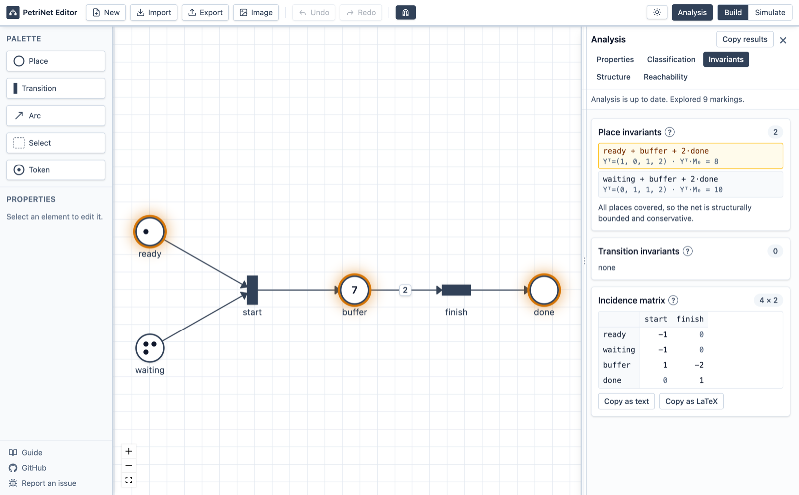

# PetriNet Editor

A free Petri net editor and simulator that runs in your browser. Draw a classic place/transition
net, fire its transitions, and check its properties in the Analysis panel.

Open the editor at [petrinet.anikiej.com](https://petrinet.anikiej.com). New to Petri nets? The
[guide](https://petrinet.anikiej.com/guide) explains the basics and every part of the editor.

The app runs entirely in your browser. There is no account and nothing to install. The editor
saves your net and your view in the browser as you work. The app sends nothing you draw to a
server.




## Features

### Build

- Put places and transitions on an infinite grid. Pan and zoom freely.
- Draw arcs between them. The editor never joins two places or two transitions.
- Bend an arc around other shapes. Click empty canvas while you draw it to add a corner. On a
  selected arc, drag a corner to move it, or double-click it to remove it.
- Give an arc a weight. A weight above 1 shows on the arc.
- Set the starting tokens with the Token tool or in the Properties panel.
- Rename shapes, rotate transitions, and delete anything you select.
- Copy and paste, undo and redo.
- Shapes snap to the grid, and guides appear when a shape lines up with its neighbours. The
  magnet button turns snapping off.

### Simulate

- Simulate mode locks the structure of the net, so you cannot change it by accident.
- Click an enabled transition to fire it.
- Step fires one enabled transition. Play fires them one after another, at 1, 2, 5 or 10 per
  second, until no transition can fire. When several transitions are enabled, the app picks one
  at random.
- The history lists every firing. Click a row to jump back to that state. Reset returns to the
  starting tokens.
- Click a place to add a token during a run. Shift-click removes one.

### Analysis

The Analysis panel checks the net and explains each result. It has five tabs:

- Properties: bounded, safe, conservative, live, reversible and deadlock-free, each with its
  reason. It also shows the largest token count that each place reaches.
- Classification: ordinary, state machine, marked graph and free choice.
- Invariants: place invariants, transition invariants and the incidence matrix. You can copy the
  matrix as text or as LaTeX.
- Structure: loops, and facts such as the source and sink places.
- Reachability: ask whether a given marking is reachable. After the full analysis, a table shows
  the reachable markings and the firings between them. You can copy the table.

Some results update as you edit. The full analysis explores up to 10,000 markings, and it runs
when you click Analyse. Click a result to light up its places, transitions or arcs on the canvas.
Each result has a help card behind its question mark. The card explains the term, says what the
result tells you, and gives an example. Copy results puts the whole analysis on the clipboard as
plain text, ready for a report.

### Import and export

- Import opens a `.npn` or PNML file. You can also drop a file anywhere on the editor.
- The editor refuses a PNML file with inhibitor or other special arcs, with place capacities, or
  with a net type other than place/transition. The message says why.
- Export saves the net as a file that you can import again: a `.npn` file, or PNML for other
  Petri net tools. The file always holds the starting tokens.
- Image saves a picture of the net: PNG image, SVG image or LaTeX (TikZ). Copy to clipboard puts
  a PNG picture on the clipboard.
- A picture shows the tokens that are on screen, so you can capture a net in the middle of a run.
  Pictures always have a light background, also in dark mode.

### Theme and phone

- Choose System, Light or Dark. System follows the setting of your computer. The canvas turns
  dark too.
- On a phone, the editor switches to a layout for small screens.

## Tech stack

| Layer | Choice |
| --- | --- |
| Language | TypeScript (strict) |
| UI | React 18 |
| Build tool | Vite |
| Canvas | React Flow (`@xyflow/react`) |
| State / history | Zustand + zundo |
| Styling | Tailwind CSS |
| Tests | Vitest |
| Lint / format | Biome |
| Runtime / package manager | Bun |

## Getting started

Prerequisites: [Bun](https://bun.sh).

```sh
bun install      # install dependencies
bun run dev      # start the dev server -> http://localhost:5173
```

### Scripts

```sh
bun run dev         # Vite dev server
bun run build       # typecheck + production build + pre-built guide page -> dist/
bun run preview     # serve the production build locally
bun run typecheck   # tsc --noEmit
bun run lint        # biome check
bun run format      # biome format --write
bun run test        # run the unit tests (Vitest)
bun run test:watch  # run the unit tests in watch mode
```

### Docker

A multi-stage image builds the app and serves the static bundle with a tiny pure-Bun server:

```sh
docker build -t petrinet .
docker run --rm -p 3000:3000 petrinet   # http://localhost:3000
```

## The `.npn` format

The editor reads and writes `.npn`, a single-line minified JSON document (UTF-8 with BOM) describing a
net's `places`, `transitions`, and `arcs`. Two properties make the codec careful:

- **Byte-faithful export**: keys are written in a fixed canonical order and serialized with no
  spacing, so exporting an unedited file reproduces the original bytes exactly. Unit tests check
  this round trip on small sample nets.
- **Lenient, forward-compatible import**: structure is validated (malformed input fails with a
  clear, specific error, never a silent partial load), optional fields default sensibly, and unknown
  per-element fields are preserved so a file produced by a newer version survives a round-trip
  unchanged.

## Architecture

The normalized domain model (`places` / `transitions` / `arcs`) is the **single source of truth**;
the React Flow nodes and edges are derived from it, and interactions map back into it. The firing
engine is **pure and framework-free** (no React, no DOM) and exposes `enabledTransitions()` and
`fire()` with the firing policy decoupled, so it stays unit-testable and reusable.

The analysis code in `src/domain/analysis` follows the same rule. It is plain TypeScript classes
with no React and no DOM, and unit tests cover it.

The build pre-renders the guide into its own HTML page, so the guide text is in the page before
any script runs. The Bun server in `server.ts` serves that page at `/guide`.

## Feedback

Found a bug, or have an idea? [Open an issue](https://github.com/AnakinM/petrinet/issues) on
GitHub.

## License

[MIT](LICENSE) © 2026 Mateusz Anikiej. Free to use, modify, and distribute.
